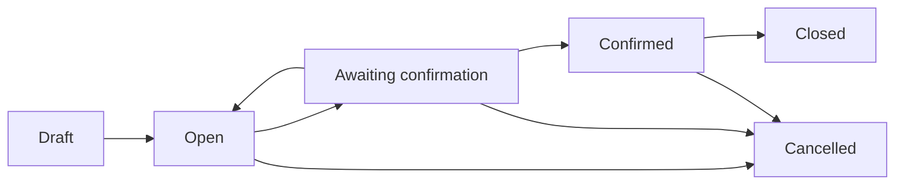

# Product specification — bounded campus prototype

Date: 2026-10-10 (Asia/Kolkata)

This specification derives from the plan and synthetic scenarios, not completed field research. It is provisional until campus/partner validation.

## Scope and roles

One IIITM Gwalior community, one collection drive and one organiser workflow. A partner is represented by an organiser's recorded external confirmation; it has no login or independent permission.

| Action / information | Resident | Organiser |
|---|---|---|
| Campus totals and agreed instructions | Read | Read |
| Resident requests/contact/photos | Own only | All in this campus |
| Submit request while drive open | Yes | Supported by API; resident UI preferred |
| Withdraw before confirmation | Own only | Cannot impersonate resident |
| Review / assign / confirm / cancel / close | No | Yes |
| Handover counts and weight | Own records, no receipts | All; may create |
| Receipt / downstream document files | No | Yes |
| Assign Cognito role or membership | No | No application API; trusted AWS administrator only |

AppSync authorises admitted Cognito groups. Lambda rechecks claims, identity, record ownership and state. No client-supplied community/role grants access. Another campus needs its own backend and admission groups; users with unrelated groups are denied.

## Lifecycle

Requests: Submitted → Accepted / Needs clarification / Rejected. Accepted → Assigned. Before confirmation, the owning resident may withdraw Submitted, Accepted, Needs clarification or Assigned requests. Assigned → Partial handover → Handed over; Assigned may become No show. Closure marks remaining Assigned requests Uncollected; partial requests retain their received count and visible remainder. Cancellation preserves received items and returns uncollected Assigned requests to Accepted, but the cancelled drive cannot collect more.

Partner confirmation must include every assigned category, partner identity, source/timestamp, date/location, fees/terms and instructions. New requests are accepted only in Open. A submitted request or assigned batch does not itself indicate partner acceptance.

## Metrics

- Active requests/items exclude withdrawn/rejected records.
- Participation is unique requesting **accounts**, not verified households.
- Estimated kg: sum of non-withdrawn/non-rejected estimates; unknown values contribute no estimate.
- Confirmed items: requests assigned to the confirmed batch; distinct from handover.
- Received items and measured kg: sums of saved handovers, including partial handovers.
- Evidenced recycling kg: sum of separate downstream evidence records, bounded by measured handover kg.
- No carbon savings, rewards or payments. Demo data exists only in the browser demo namespace; cloud branches start empty.

## Privacy and operating assumptions

Residents retain devices until agreed handover. Partner handling instructions must address special items; no unattended storage arrangement is created. Device data-removal guidance does not certify erasure.

Contact preference is visible only to the resident and organiser. No public data endpoint exposes it. For a real pilot, agree a retention policy with the community before inviting residents; proposed default is export anonymised results and remove identifiable contact/photo records within 90 days of drive closure. Deletion/export requires the trusted AWS administrator and is not yet automated. Never commit pilot records or receipts.

## Prioritised backlog

1. Live cloud integration and hosted authorisation tests.
2. Real partner/community validation and usability sessions.
3. Pilot-approved export/retention implementation.
4. Multi-drive data architecture if the pilot exceeds 100 requests.
5. Notifications or dedicated partner portal only if field feedback supports them.

## Review hardening (2026-10-10)

Confirmation rechecks that a non-empty assigned batch still exists, even if residents withdrew after Awaiting confirmation. All command timestamps require explicit offsets; the UI supplies IST for evidence as well as collection and handover. Confirmation/proposal cannot schedule a past collection. Real confirmation, handover and evidence timestamps cannot be future outcomes; demo simulations may be future but must preserve event ordering. Recycling can only credit weight already handed over by the evidence timestamp.

The API authorises upload issuance and attachment linking independently. Closed/rejected/withdrawn/completed request photos are immutable, existing photos and receipts cannot be replaced, and saved document reads remain authorised after closure. S3 POSTs write pending/; the backend verifies metadata and copies to private/ before committing the reference. Seven-day pending/ expiry cannot delete linked private/ documents. A database write failure after copying can leave a private orphan requiring administrator reconciliation.

Processed action IDs hold fixed-size SHA-256 command digests. Legacy demo payloads remain replay-compatible and migrate to digests on the next write. The deployment remains one drive and one DynamoDB item; closing it does not expose a new-drive button or erase previous pilot history.
